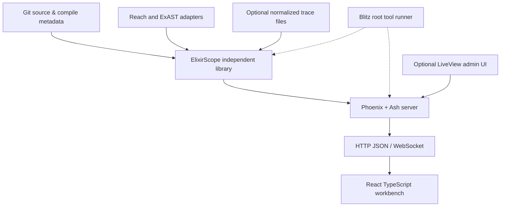

# Poncho monorepo architecture — small kernel, independent delivery

## Repository layout

```text
elixir_scope/                         # Git monorepo; NOT umbrella
  mix.exs                             # tooling-only Mix workspace project (Blitz)
  mix.lock                            # root tooling lock
  .mise.toml                          # pinned Erlang/Elixir/Node (example)
  .tool-versions                      # optional asdf equivalent, not both as competing authorities
  .gitignore
  apps/
    elixir_scope/
      mix.exs                         # independent library app
      mix.lock                        # isolated lock; versioned
      lib/elixir_scope/
        source/                       # revision, SourceRef, symbols
        analysis/                     # Reach, ExAST adapters and normalizers
        trace/                        # normalized event model, importers, bounded queries
        correlation/                  # source/event, process/message causal relations
        investigation/                # pure focus/evidence projections
      test/
    elixir_scope_server/
      mix.exs                         # independent Phoenix/Ash app
      mix.lock
      lib/elixir_scope_server/
        application.ex
        repo.ex
        domains/                      # Ash codebase, review, optional capture
        ingest/                       # import worker, job orchestration
      lib/elixir_scope_server_web/
        controllers/                  # JSON endpoints
        channels/                     # optional event/status streams
        live/                         # optional diagnostic console only
      priv/repo/migrations/
      test/
  web/
    package.json                      # separate pnpm/npm workspace
    pnpm-lock.yaml
    src/
      domain/                         # type-safe API schema and focus model
      workspace/                      # Dockview shell and commands
      views/                          # diff, source, graph, score, state, evidence
      workers/                        # trace aggregation and graph layout
      api/                            # typed client and caching
    tests/
  fixtures/
    otp_recovery/                     # real Mix sample app as test fixture, if created
  docs/
  scripts/
```

The two `apps/*` children each have their own `mix.exs`, root only owns orchestration. There is no `apps_path` `Mix.Project` umbrella configuration, no umbrella-wide application list, no shared build directory by default. `elixir_scope_server` declares `{:elixir_scope, path: "../elixir_scope"}` as an ordinary Mix path dependency; publishable engine must also build and test independently without the server directory present.

The root Mix project is a tooling convenience, not a third runtime service. It may use `{:blitz, "~> 0.4.1", runtime: false}` for `mix blitz.workspace test`. See `05-delivery/01-poncho-blitz-mise.md` and `examples/mix/`.

## Dependency arrows



Rules:

1. `elixir_scope` **MUST NOT** import Ash, Phoenix, HTTP controllers, browser UI state or database `Repo` modules.
2. `elixir_scope_server` owns persistence, authorization and HTTP transport. It may run analysis library computations in bounded Tasks or job workers; blocking the request path on entire-repository indexing is prohibited.
3. Browser never imports server/engine internals; JSON schema and semantic versioning define the boundary.
4. Runtime probe, if introduced, depends on a small versioned trace format, not the server process, Ash, or the TS app. An offline capture recording is always loadable without a live target BEAM node.
5. Neither Reach nor ExAST raw internal node IDs leak into saved Finding IDs or public API stable identity.

## Engine functional API categories

These function signatures are *design contracts, not compiled source*:

```elixir
ElixirScope.Source.index_revision(repo, revision, opts)
ElixirScope.Analysis.changed_symbols(index, base, head, opts)
ElixirScope.Analysis.neighborhood(index, source_ref, opts)
ElixirScope.Analysis.impact(index, source_ref, opts)
ElixirScope.Analysis.effect_paths(index, source_ref, opts)
ElixirScope.Trace.import_recording(path, opts)
ElixirScope.Trace.events(recording, query)
ElixirScope.Correlation.explain_event(recording, index, event_id)
ElixirScope.Correlation.causal_slice(recording, origin_id, opts)
ElixirScope.Investigation.project(focus, providers, opts)
```

Commands return `{:ok, %{data: ..., coverage: ..., provenance: ...}} | {:error, reason}`. For missing analysis facts, return an explicit diagnostic reason, not empty successful results indistinguishable from 'no relationship'. Consumers may work with pure data without starting application services.

## Synchronization boundaries

**Index/build:** Git checkout/working copy input → immutable revision/candidate diff → analysis passes → normalized source relationships → Ash persistence *optional* and async.

**Review browsing:** UI asks for bounded impact/related code; Phoenix serves cached results, or schedules a normalizer query when not indexed. Source text served by exact revision and path, never current disk content by accident.

**Cinema import:** Recorder/file input → validated trace header/schema → chunk index → source correlation against the recording's code identity → UI windows with coverage metadata. Never mutate source graph to 'make it match' a trace.

**Live stream (later):** Optional Phoenix Channel broadcasts job status and newly persisted bounded event batches; UI controls timeline locally and reconnects by immutable cursors. No per-frame LiveView patch protocol.

## Modules to implement first

Within engine: `SourceRef`, `SymbolRef`, `Revision`, `SourceIndex`, `Analysis.Adapter`, `Analysis.Reach`, `Analysis.ExAST`, `Relation`, `Evidence`, `Neighborhood`, `DiffNormalizer`, `QueryContext`. Optional one ETS cache under a dedicated process only when needed. No blanket behaviors for trivial pure functions.

Within server: `Domains.Codebase.{Repository,Revision,Symbol,Relation}`, `Domains.Review.{Investigation,Finding}`, `IndexJob` or `Task.Supervisor`, a handful of thin controllers. LiveView optional internal diagnostics.

Within UI: `Focus`, `WorkspaceCommand`, Dockview layout registry, pinned source pane, semantic navigator, source/diff view, bounded graph, finding composer, mock fixture client.

## BEAM-language extensibility without premature breadth

Persist `language` and `source_kind`; an adapter can state capabilities like `definitions`, `structural_diff`, `calls`, `dataflow`, `otp`, `source_spans`, `macro_resolution`. If a language lacks some feature, the pane explains that rather than returning fabricated equivalence. Reach's documentation covers Elixir, Erlang and Gleam; ExAST's structural matcher is Elixir-specific. Do not force Gleam AST into Elixir nodes.

## Decisions intentionally left open

Endpoint hosting shape, background job technology, external database, trace blob object storage, auth provider and deployment tenancy. Keep configuration and schema boundaries that permit later choices, but do not build abstractions before requirement evidence exists.
